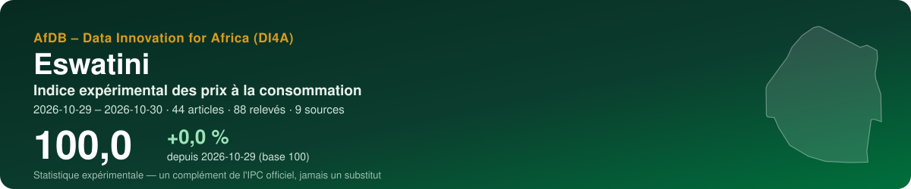
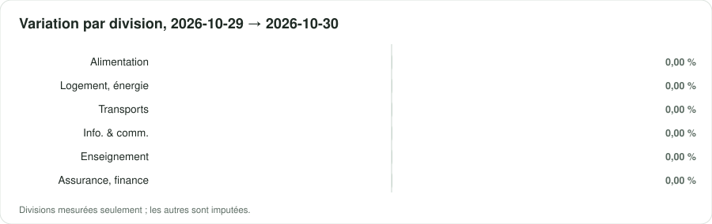
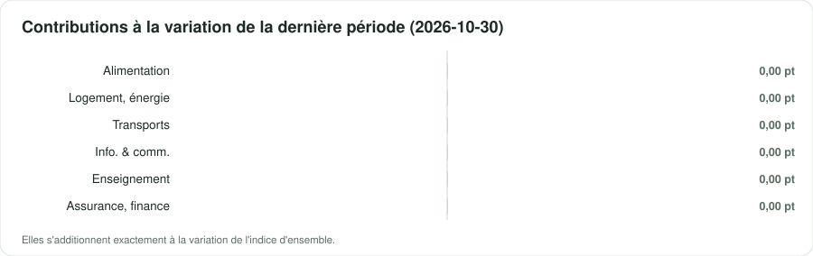

<p align="center"></p>

<p align="center">
  <a href="https://datainnov4africa-web.github.io/cpi-sz/"><b>▶ Ouvrir le tableau de bord</b></a> · <a href="README.md">English version</a>
</p>

<p align="center">
      
</p>

## En bref

| Indicateur | Valeur |
|---|---|
| **Indice d'ensemble** | **100,0** (+0,0 % depuis 2026-10-29) |
| Variation de la dernière période | +0,00 % |
| Fenêtre | 2026-10-29 → 2026-10-30 · par date de collecte |
| Données | 88 relevés · 44 articles · 9 sources |
| Divisions COICOP mesurées | 6 / 13 |
| Pondérations | officielles — Central Statistical Office (CSO), Consumer Price Index July 2026 (released 14 August 2026), Table 2 'CPI, annual and monthly changes for mai |
| Devise | SZL (E) |

> [!IMPORTANT]
> Statistique expérimentale construite à partir de prix publiés en ligne (boutiques, régulateurs, services publics, données de marché). Un complément de l'indice officiel des prix de l'institut national de la statistique — jamais un substitut.

<p align="center"></p>

## Messages clés

| Confiance | Message | Pourquoi |
|---|---|---|
| 🟠 Faible | Entre 2026-10-29 et 2026-10-30, l'indice expérimental a varié de +0,0 % (2 périodes, 44 articles). | Des dates de collecte dans un seul mois : un mouvement de court terme, pas encore une tendance mensuelle. |
| 🟡 Moyenne | Sur la dernière période, la plus forte contribution vient de la division 12 (Assurances et services financiers) : +0,00 point de pourcentage. | Les contributions s'additionnent exactement à la variation de l'indice d'ensemble. |
| 🟡 Moyenne | Les divisions mesurées pèsent 80 % du panier officiel. | Être atteint n'est pas être représenté : un groupe peut être suivi par quelques articles en ligne éloignés de ses variétés officielles. Les groupes non mesurés sont imputés par ceux qui le sont. |
| 🟡 Moyenne | Échantillonnage des articles : le dernier indice se situe entre 100,0 et 100,0 dans 90 % de 100 réplications bootstrap. | L'intervalle couvre le choix des articles collectés, pas le biais des prix en ligne face aux prix en magasin. |

## Par division COICOP

<p align="center"></p>

| | Division | Poids % | Articles | Variation % | Contribution, dernière période (pt) |
|---|---|---:|---:|---:|---:|
| 01 | Produits alimentaires et boissons non alcoolisées | 20,1 | 4 | 0,00 | 0,000 |
| 02 | Boissons alcoolisées, tabac et stupéfiants | 5,0 | — | imputée | — |
| 03 | Articles d'habillement et chaussures | 5,6 | — | imputée | — |
| 04 | Logement, eau, électricité, gaz et autres combustibles | 27,7 | 5 | 0,00 | 0,000 |
| 05 | Meubles, équipements ménagers et entretien courant | 4,7 | — | imputée | — |
| 06 | Santé | 1,3 | — | imputée | — |
| 07 | Transports | 17,5 | 6 | 0,00 | 0,000 |
| 08 | Information et communication | 7,4 | 15 | 0,00 | 0,000 |
| 09 | Loisirs, sports et culture | 1,8 | — | imputée | — |
| 10 | Services d'enseignement | 6,6 | 1 | 0,00 | 0,000 |
| 11 | Restaurants et services d'hébergement | 0,2 | — | imputée | — |
| 12 | Assurances et services financiers | 0,7 | 13 | 0,00 | 0,000 |
| 13 | Soins personnels, protection sociale et divers | 1,4 | — | imputée | — |

*Imputée* : aucun prix lu pour la division ; elle évolue comme les divisions mesurées (Manuel de l'IPC 2020, ch. 6).

<p align="center"></p>

## Sources

12 sources actives au registre, 17 exclues avec leur motif. Chaque requête du robot lit d'abord le robots.txt ; un refus est consigné, jamais contourné.

| Source | Type | COICOP | Statut | Relevés de cette exécution |
|---|---|---|---|---:|
| [MTN Eswatini — prepaid voice bundles](https://www.mtn.co.sz/mtn_tag/voice/) | tarif réglementé | 08 | partielle | 16 |
| [Eswatini Mobile — No Frills monthly plans](https://eswatinimobile.co.sz/no-frill-contracts/) | tarif réglementé | 08 | vérifiée | 14 |
| [Standard Bank Eswatini — Personal & Private Banking pricing guide (account and transaction fees)](https://sponsorships.standardbank.com/static_file/Eswatini/FileDownloads/2025%20Standard%20Bank%20Eswatini%20Pricing%20Guide.pdf) | tarif réglementé | 12 | partielle | 14 |
| [MTN MoMo Eswatini — send-money and ATM cash-out fees](https://www.mtn.co.sz/momo/momo-personal/fees/) | tarif réglementé | 12 | vérifiée | 12 |
| [EEC — 2026/27 residential electricity tariffs](https://www.eec.co.sz/domestic/tariffs/) | tarif réglementé | 04 | vérifiée | 8 |
| [Gazetted public transport fares (bus, midibus, minibus)](https://www.eswatiniobserver.com/?p=13464) | tarif réglementé | 07 | partielle | 8 |
| [Maximum Wholesale and Retail Prices of Bread Notices, 2025 and 2026 (Price Control Order 1973)](https://www.eswatiniobserver.com/bread-price-goes-up-by-7/) | tarif réglementé | 01 | vérifiée | 8 |
| [Ministry of Natural Resources and Energy — regulated fuel prices](https://times.co.sz/45228/news/tough-times-as-fuel-prices-edge-close-to-e30-per-litre/) | tarif réglementé | 07, 04 | vérifiée | 6 |
| [University of Eswatini (UNESWA) — standard tuition fee](https://www.eswatiniobserver.com/uneswa-introduces-standard-tuition-fee-of-e26-000-for-all-students/) | tarif réglementé | 10 | partielle | 2 |
| [MTN Eswatini — prepaid top-up data bundles](https://www.mtn.co.sz/mtn_tag/mobile-data/) | tarif réglementé | 08 | partielle | 0 |
| [World Bank — official CPI (annual)](https://api.worldbank.org/v2/country/SWZ/indicator/FP.CPI.TOTL) | référence officielle | — | partielle | 0 |
| [IMF DataMapper — inflation (WEO)](https://www.imf.org/external/datamapper/api/v1/PCPIPCH/SWZ) | référence officielle | — | partielle | 0 |

<details><summary>17 sources exclues et pourquoi</summary>

- **WFP market prices (HDX)** — Le jeu est « Kingdom of Eswatini - Food Prices » (identifiant wfp-food-prices-for-kingdom-of-eswatini, pas ...-for-eswatini) ; il couvre du 15/04/2004 au 15/08/2023, modifié le 20/08/2023, mis à jour « au besoin ». Aucune observation depuis trois ans : à réactiver si les mises à jour reprennent. Revérifié le 29/10/2026 : la page du jeu est inchangée (15/04/2004 - 15/08/2023, modifiée le 20/08/2023) ; la vitrine HDX « Eswatini - Food Prices showcase » affiche une période allant jusqu'au 15/04/2024 (modifiée le 21/07/2024). Dans les deux cas, la dernière observation date d'au moins 30 mois.
- **World Bank RTFP — monthly food price estimates** — L'Eswatini ne figure pas parmi les 37 pays du catalogue RTFP (version du 24/08/2026).
- **FEWS NET market prices** — Aucun indice que FEWS NET publie des prix de marché pour l'Eswatini : la recherche n'a renvoyé ni bulletin ni jeu de prix ; la note pays FAO GIEWS (25 août 2026) ne donne aucun prix intérieur, seulement le maïs blanc sud-africain. À rouvrir si l'entrepôt de données FEWS NET renvoie des lignes pour country_code=SZ.
- **Supermarket chains (Pick n Pay, Shoprite/Checkers, Spar) — online prices** — Aucune boutique en ligne avec des prix eswatiniens en emalangeni n'a été trouvée pour ces chaînes (les recherches Pick n Pay, Shoprite/Checkers et Spar Eswatini ne renvoient que des sites sud-africains ; une seconde recherche d'épicerie en ligne à Mbabane n'a renvoyé que des guides de voyage et une boutique ensiglo.com inactive). Les prix en ligne sud-africains ne doivent pas servir de prix eswatiniens malgré la parité avec le rand. La seule plateforme locale citée (Buy-Eswatini, guide commercial américain) n'a ni adresse ni prix trouvés. Passe approfondie (29/10/2026), cinq recherches de plus : prospectus Shoprite Eswatini, Pick n Pay Eswatini en ligne, promotions Boxer Eswatini, applis de livraison à Mbabane/Manzini, toute boutique avec panier en emalangeni. Résultats : prospectus et comparatifs sud-africains, l'appli Checkers Sixty60 (Afrique du Sud seulement), une boutique d'artisanat (madeineswatini.store, aucun prix vu) et une page ensiglo.com inactive. Aucune page de prix propre à l'Eswatini n'existe pour ces chaînes.
- **Eswatini Water Services Corporation — water tariffs** — Aucun barème d'eau actuel trouvé en ligne (quatre recherches en deux passages ; seulement un article de 2021 ; les articles 2026 sur l'ESERA ne traitent que de l'électricité). L'IPC montre +4,0 % sur un an pour l'eau et un indice stable mai-juin 2026 (162,83), soit un changement par an. Demandé à l'EWSC/ESERA. Passe approfondie (29/10/2026) : deux recherches de plus (tarif EWSC 2026 au kilolitre ; approbation par l'ESERA) n'ont renvoyé que l'électricité et des services étrangers. Toujours aucun texte primaire en ligne.
- **Rental listings (Mbabane, Manzini)** — Quatre recherches en deux passages n'ont renvoyé que des plateformes de court séjour (Airbnb, Expedia, Travelocity), qui ne mesurent pas les loyers résidentiels. La seule agence avec une section Eswatini (Pam Golding, explore/eswatini) n'affiche que des biens à vendre, 0 location. Aucun site local d'annonces ou d'agence avec des loyers mensuels en E trouvé. Les loyers effectifs (18,19 % ; indice IPC 120,28, +3,3 % sur un an en juin 2026, stable mai-juin) ne sont pas mesurés : demander les loyers moyens du CSO. Passe approfondie (29/10/2026), sept recherches de plus : Property24 Eswatini, Seeff et RE/MAX Eswatini, agences locales (Mbabane, Manzini, Ezulwini), petites annonces « to let », loyers du National Housing Board et articles sur les hausses de loyer. Résultats : de nouveau seulement Airbnb, Expedia, Travelocity, hotels.com et des agrégateurs de coût de la vie, plus Pam Golding (ventes seulement). Aucun site ne publie de loyers résidentiels de longue durée en E : aucune fiche html_listing n'est possible.
- **Third-party fuel price trackers (openvan.camp, afrotools)** — Inutiles : la contradiction apparente s'explique par la chaîne du ministère désormais dans sz_fuel_prices (29,40 / 32,25 / 25,16 E d'openvan.camp sont les prix du 2 oct. 2026 ; 25,97 / 28,85 E d'afrotools ceux du 4 sept. 2026, donc en retard). Ils ne donnent pas de date d'effet et leurs graphiques d'historique sont incohérents.
- **Restaurant menus / food delivery** — Aucune plateforme de livraison avec menus n'a été trouvée en Eswatini ; seulement des moyennes participatives non datées, qui ne mesurent pas de prix représentatifs (la division 11 pèse 0,19 %). Passe approfondie (29/10/2026) : une recherche des menus KFC, Nando's et Debonairs en Eswatini n'a renvoyé que des menus sud-africains et des restaurants Uber Eats d'Afrique du Sud, qui ne sont pas des prix eswatiniens.
- **FAO GIEWS FPMA — Eswatini retail maize meal** — Corrigé à la passe approfondie (29/10/2026). L'article de thebrief.com.na (?p=22147) qui cite le bulletin FPMA de la FAO (« retail maize meal prices in Botswana, Eswatini, Lesotho and Namibia generally remained stable between June and July ») date du 16 septembre 2025, et non du 31 juillet 2026. La date relevée aux passes précédentes était l'en-tête de page du site. Le constat porte donc sur juin-juillet 2025. Il laisse penser que la FPMA tient une série de prix de détail de la farine de maïs eswatinienne, mais deux recherches de plus n'ont trouvé ni page de série FPMA, ni liste de marchés, ni dernière date, la note pays GIEWS ne publie aucun prix eswatinien, et la page de revue régionale de la FAO ouverte ce jour affiche « The content is not available ». Candidat pour 01.1.1 seulement après confirmation par un humain de la série, de ses marchés et de sa dernière observation dans l'outil FPMA. Le jeu FAOSTAT « Eswatini - Food Prices » sur HDX ne contient que des indices de prix et des déflateurs (jusqu'en févr. 2024) : ce n'est pas une source de prix.
- **NAMBoard produce prices / Competition Commission price monitoring / NMC maize prices** — Recherché au second passage et de nouveau à la passe approfondie (29/10/2026, cinq recherches : prix de marché du NAMBoard, suivi du panier alimentaire par la Commission de la concurrence, contrôle des prix de la farine de maïs, du sucre et de l'huile par le ministère du Commerce, prix de vente du maïs de la NMC, prix du lait du Dairy Board). Ces recherches n'ont trouvé aucune liste de prix du NAMBoard (National Agricultural Marketing Board), aucun rapport de suivi des prix de la Commission de la concurrence ou du ministère du Commerce de l'Eswatini, et aucun avis de prix 2026 de la NMC (National Maize Corporation) ; le dernier élément NMC est un titre de presse de 2024. Elles ont renvoyé les rapports horticoles du NAB namibien, les rapports du NAMC et de la Commission de la concurrence sud-africains, et le Price Control Order de 1973 sur eswatinilii.org, qui est la loi d'habilitation, sans barème en vigueur. Ces sources sont étrangères ou hors détail : aucune n'est utilisée. S'adresser directement au NAMBoard et à la NMC.
- **Manzini Government Hospital — consultation fee** — Passe d'enrichissement (28 oct. 2026). Depuis le 1er juin 2026, le Manzini Government Hospital facture 10 E la consultation aux heures ouvrables et 20 E en dehors (Eswatini Observer, 2 juin 2026) ; les patients de 60 ans et plus restent exemptés. Le service était gratuit avant : le prix passe de zéro à 10 E, sans variation relative mesurable. C'est aussi la décision d'un seul établissement, pas un barème national, et la saisir ferait paraître la santé (1,27 %) couverte par un article isolé. Demander au ministère de la Santé si les frais d'usagers de tous les hôpitaux publics ont changé en 2026.
- **Alcohol and tobacco — South African excise changes quoted for Eswatini** — Passe d'enrichissement (28 oct. 2026). L'Eswatini Observer (26 févr. 2026) rapporte les hausses d'accises sud-africaines 2026/27 à partir de mars : paquet de 20 cigarettes 22,81 → 23,58 R d'accise, bière ou cidre 340 ml +8 cents, vin 750 ml +15 cents, spiritueux 750 ml +3,20 R. Il estime qu'elles se répercutent en Eswatini en raison des importations et de la parité avec le rand. Ce sont des accises sud-africaines, pas des prix en rayon eswatiniens, et l'article ne dit rien des accises propres à l'Eswatini. Aucun barème d'Eswatini Beverages ni d'un détaillant en E n'a été trouvé (deux recherches). La division 02 (5,02 %) reste imputée. Passe approfondie (29/10/2026), deux recherches de plus : prix de la bière d'Eswatini Beverages en 2026, prix des cigarettes ou accises 2026 de l'Eswatini Revenue Service. Elles n'ont trouvé qu'un article du Times de 2023, un autre de 2024 (« SA's sin tax to hit Eswatini consumers ») et des pages participatives de coût de la vie, sans liste de prix en rayon en E.
- **IPC acute food insecurity report — staple prices quoted (Jun 2026 - Mar 2027)** — Passe approfondie (29/10/2026). Le rapport IPC publié le 31 juillet 2026 donne un jeu unique de prix d'aliments de base : « beans at 27.38 Swazi lilangeni (SZL) per kg, maize meal at SZL 13.44 per kg, and rice at SZL 15.73 per kg ». Il indique aussi que la farine de maïs et le riz étaient « 11-percent above the five-year average by March 2026 ». Il ne cite ni marché, ni date de relevé, ni source, et le prochain cycle IPC est à plusieurs mois. C'est un instantané unique et non sourcé, pas une série : il ne peut pas porter la division 01. Il est conservé comme contrôle de vraisemblance des niveaux alimentaires (farine de maïs environ 13,4 E le kg, contre un maximum de 15,26 E pour un pain complet de 700 g) et comme piste : demander au VAC de l'Eswatini de quelle enquête de marché proviennent ces moyennes.
- **MultiChoice Eswatini — DStv package prices** — Passe approfondie (29/10/2026), deux recherches. Aucune grille MultiChoice Eswatini en E n'a été trouvée. Le seul élément eswatinien, un article non daté (« DStv price hikes won't affect Eswatini subscribers »), cite des prix sud-africains (Premium 839 E, Compact Plus 549 E à compter d'un 1er avril d'année non précisée) et indique que MultiChoice Eswatini n'avait pas été avisée des hausses. Les prix eswatiniens peuvent donc différer des prix sud-africains, qui ne doivent pas être utilisés. La télévision payante serait un article représentatif pour la 09 (1,78 %) : demander à MultiChoice Eswatini ses tarifs en vigueur et leurs dates d'effet.
- **LPG (cooking gas) retail prices** — Passe approfondie (29/10/2026). Le gaz pèse 1,41 % (classe 04.5.2), plus que le pétrole lampant (0,53 %). Une recherche de prix du GPL au kg en Eswatini n'a trouvé que des sites tiers de suivi des carburants et des régulateurs étrangers. Le format de communiqué du ministère (lu pour janvier 2024) ne couvre que l'ULP95, le gazole et le pétrole lampant : le GPL ne semble pas réglementé. Aucune liste de prix en E d'un détaillant ou distributeur n'a été trouvée. Demander au ministère des Ressources naturelles et de l'Énergie et à l'ESERA si les prix du GPL sont suivis.
- **Waterford Kamhlaba — fee schedules 2026 and 2027** — Passe approfondie (29/10/2026). Une recherche des frais de scolarité secondaires 2026 n'a renvoyé que les barèmes publiés de cet internat international (PDF 2025, 2026 et 2027 approuvé, non ouverts). Une école d'élite ne représente pas la dépense d'éducation des ménages, et les frais du secondaire public varient selon l'école, sans barème national trouvé. Les frais de l'UNESWA restent la fiche de la division 10. Demander au ministère de l'Éducation les fourchettes de frais complémentaires approuvées pour les écoles secondaires publiques.
- **Retail pharmacy medicine prices** — Passe approfondie (29/10/2026), deux recherches : prix des médicaments, frais de consultation privée et frais d'usagers ; pharmacies en ligne en E. Elles n'ont trouvé aucune pharmacie en ligne avec des prix en E, ni liste nationale de prix des médicaments ou barème des Central Medical Stores. Les seules données de prix sont universitaires : une enquête de 2021 sur les prix des médicaments sur ordonnance en pharmacie (African Journal of Primary Health Care & Family Medicine) et une thèse liée. Ce sont des enquêtes ponctuelles, pas une série. Les frais de l'hôpital de Manzini restent exclus (voir sz_hospital_consultation_fee). La santé (1,27 %) reste imputée.

</details>

## Méthode

Articles appariés ; indices élémentaires de **Jevons** par classe COICOP 2018, points de vente en strates de poids égal ; imputation explicite des prix manquants (deux périodes au plus, onze pour les produits saisonniers) ; remplacements raccordés avec ajustement de quantité ; agrégation avec les poids officiels sous forme **Young/Lowe**, chaînée ; GEKS pour contrôler la dérive de chaînage ; intervalle bootstrap à 90 %. Comme le prescrit le *Manuel de l'indice des prix à la consommation* (FMI et al., 2020). Détails : [docs/METHODOLOGIE.md](docs/METHODOLOGIE.md).

## Données

Copies ouvertes, lisibles par machine, de ce que montre le tableau de bord :

- [`data/index_all_items.csv`](data/index_all_items.csv) — indice d'ensemble par période, avec son intervalle à 90 %
- [`data/index_divisions.csv`](data/index_divisions.csv) — indice de chaque division mesurée
- [`data/contributions.csv`](data/contributions.csv) — contributions des divisions à chaque variation, en points
- [`data/basket.csv`](data/basket.csv) — poids, articles et variation par division
- [`data/sources.csv`](data/sources.csv) — le registre des sources et ce que l'exécution a obtenu de chacune
- [`data/metadata.json`](data/metadata.json) — pays, périodes, pondérations et chiffres clés

## Reproduire

L'indice est produit par la boîte à outils ouverte **cpi-di4a** en deux notebooks : le notebook 1 collecte poliment les prix (robots.txt d'abord, robot identifié) et les scelle dans une archive ; le notebook 2 classe, calcule et publie ce dépôt. Choisissez le code pays, *Exécution → Tout exécuter*.

## Citer

```text
AfDB – Data Innovation for Africa (DI4A) (2026). Indice expérimental des prix à la consommation — Eswatini. https://datainnov4africa-web.github.io/cpi-sz/
```

Voir aussi [CITATION.cff](CITATION.cff).

---

<p align="center"><sub>AfDB – Data Innovation for Africa (DI4A) · généré le 2026-10-29 · code sous licence MIT ; les données collectées restent soumises aux conditions de chaque source</sub></p>
