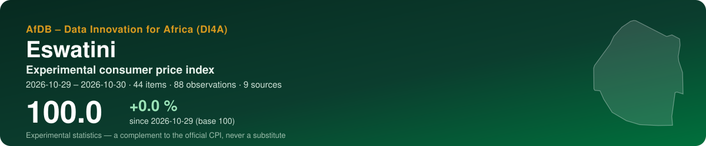
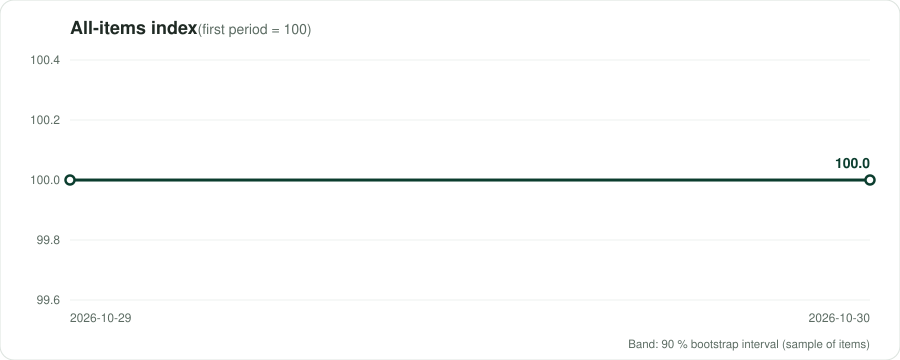
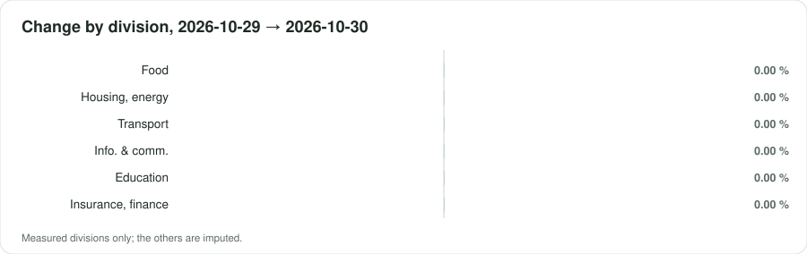
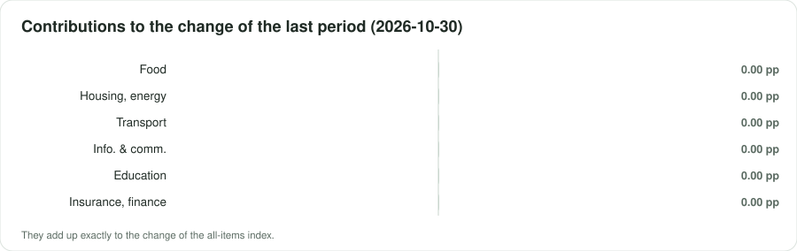

<p align="center"></p>

<p align="center">
  <a href="https://datainnov4africa-web.github.io/cpi-sz/"><b>▶ Open the live dashboard</b></a> · <a href="README.fr.md">Version française</a>
</p>

<p align="center">
      
</p>

## At a glance

| Indicator | Value |
|---|---|
| **All-items index** | **100.0** (+0.0 % since 2026-10-29) |
| Last period change | +0.00 % |
| Window | 2026-10-29 → 2026-10-30 · by collection date |
| Data | 88 observations · 44 items · 9 sources |
| COICOP divisions measured | 6 / 13 |
| Weights | official — Central Statistical Office (CSO), Consumer Price Index July 2026 (released 14 August 2026), Table 2 'CPI, annual and monthly changes for mai |
| Currency | SZL (E) |

> [!IMPORTANT]
> Experimental statistics built from prices published online (shops, regulators, utilities, market data). A complement to the official consumer price index of the national statistics office — never a substitute.

<p align="center"></p>

## Key messages

| Confidence | Message | Why |
|---|---|---|
| 🟠 Low | Between 2026-10-29 and 2026-10-30, the experimental index moved by +0.0 % (2 periods, 44 items). | Collection dates within a single month: a short-term movement, not yet a monthly trend. |
| 🟡 Medium | Over the last period, the largest contribution comes from division 12 (Insurance and financial services): +0.00 percentage point. | Contributions add up exactly to the change of the all-items index. |
| 🟡 Medium | The divisions measured weigh 80 % of the official basket. | Being reached is not being represented: a group can be followed through a few online items far from its official varieties. Unmeasured groups are imputed by the measured ones. |
| 🟡 Medium | Sampling of items: the latest index lies between 100.0 and 100.0 in 90 % of 100 bootstrap replications. | The interval covers which items were collected, not the bias of online prices against shop prices. |

## By COICOP division

<p align="center"></p>

| | Division | Weight % | Items | Change % | Contribution, last period (pp) |
|---|---|---:|---:|---:|---:|
| 01 | Food and non-alcoholic beverages | 20.1 | 4 | 0.00 | 0.000 |
| 02 | Alcoholic beverages, tobacco and narcotics | 5.0 | — | imputed | — |
| 03 | Clothing and footwear | 5.6 | — | imputed | — |
| 04 | Housing, water, electricity, gas and other fuels | 27.7 | 5 | 0.00 | 0.000 |
| 05 | Furnishings, household equipment and maintenance | 4.7 | — | imputed | — |
| 06 | Health | 1.3 | — | imputed | — |
| 07 | Transport | 17.5 | 6 | 0.00 | 0.000 |
| 08 | Information and communication | 7.4 | 15 | 0.00 | 0.000 |
| 09 | Recreation, sport and culture | 1.8 | — | imputed | — |
| 10 | Education services | 6.6 | 1 | 0.00 | 0.000 |
| 11 | Restaurants and accommodation services | 0.2 | — | imputed | — |
| 12 | Insurance and financial services | 0.7 | 13 | 0.00 | 0.000 |
| 13 | Personal care, social protection and miscellaneous | 1.4 | — | imputed | — |

*Imputed*: no price was read for the division; it moves with the measured ones (CPI Manual 2020, ch. 6).

<p align="center"></p>

## Sources

12 active sources in the register, 17 excluded with their reason. Every robot request reads robots.txt first; a refusal is recorded, never circumvented.

| Source | Type | COICOP | Status | Observations this run |
|---|---|---|---|---:|
| [MTN Eswatini — prepaid voice bundles](https://www.mtn.co.sz/mtn_tag/voice/) | regulated tariff | 08 | partial | 16 |
| [Eswatini Mobile — No Frills monthly plans](https://eswatinimobile.co.sz/no-frill-contracts/) | regulated tariff | 08 | verified | 14 |
| [Standard Bank Eswatini — Personal & Private Banking pricing guide (account and transaction fees)](https://sponsorships.standardbank.com/static_file/Eswatini/FileDownloads/2025%20Standard%20Bank%20Eswatini%20Pricing%20Guide.pdf) | regulated tariff | 12 | partial | 14 |
| [MTN MoMo Eswatini — send-money and ATM cash-out fees](https://www.mtn.co.sz/momo/momo-personal/fees/) | regulated tariff | 12 | verified | 12 |
| [EEC — 2026/27 residential electricity tariffs](https://www.eec.co.sz/domestic/tariffs/) | regulated tariff | 04 | verified | 8 |
| [Gazetted public transport fares (bus, midibus, minibus)](https://www.eswatiniobserver.com/?p=13464) | regulated tariff | 07 | partial | 8 |
| [Maximum Wholesale and Retail Prices of Bread Notices, 2025 and 2026 (Price Control Order 1973)](https://www.eswatiniobserver.com/bread-price-goes-up-by-7/) | regulated tariff | 01 | verified | 8 |
| [Ministry of Natural Resources and Energy — regulated fuel prices](https://times.co.sz/45228/news/tough-times-as-fuel-prices-edge-close-to-e30-per-litre/) | regulated tariff | 07, 04 | verified | 6 |
| [University of Eswatini (UNESWA) — standard tuition fee](https://www.eswatiniobserver.com/uneswa-introduces-standard-tuition-fee-of-e26-000-for-all-students/) | regulated tariff | 10 | partial | 2 |
| [MTN Eswatini — prepaid top-up data bundles](https://www.mtn.co.sz/mtn_tag/mobile-data/) | regulated tariff | 08 | partial | 0 |
| [World Bank — official CPI (annual)](https://api.worldbank.org/v2/country/SWZ/indicator/FP.CPI.TOTL) | official benchmark | — | partial | 0 |
| [IMF DataMapper — inflation (WEO)](https://www.imf.org/external/datamapper/api/v1/PCPIPCH/SWZ) | official benchmark | — | partial | 0 |

<details><summary>17 excluded sources and why</summary>

- **WFP market prices (HDX)** — The dataset is 'Kingdom of Eswatini - Food Prices' (slug wfp-food-prices-for-kingdom-of-eswatini, not ...-for-eswatini); it covers 15 Apr 2004 - 15 Aug 2023, last modified 20 Aug 2023, updated 'as needed'. No observation for three years: re-activate if updates resume. Re-checked 2026-10-29: the dataset page is unchanged (15 Apr 2004 - 15 Aug 2023, modified 20 Aug 2023); the HDX showcase 'Eswatini - Food Prices showcase' shows a time period to 15 Apr 2024 (modified 21 Jul 2024). Either way the last observation is at least 30 months old.
- **World Bank RTFP — monthly food price estimates** — Eswatini is not among the 37 countries of the RTFP catalogue (version 2026-08-24).
- **FEWS NET market prices** — No evidence that FEWS NET publishes Eswatini market prices: a search returned no Eswatini price bulletin or dataset; the FAO GIEWS country brief (25 Aug 2026) gives no domestic Eswatini price, only South African white maize. Re-open if the FEWS NET Data Warehouse returns rows for country_code=SZ.
- **Supermarket chains (Pick n Pay, Shoprite/Checkers, Spar) — online prices** — No online shop with Eswatini prices in emalangeni was found for these chains (searches on Pick n Pay, Shoprite/Checkers and Spar Eswatini returned only South African sites; a second-pass search for online grocery in Mbabane returned travel guides and an inactive ensiglo.com shop). South African online prices must not be used as Eswatini prices despite the rand link. The only local platform named (Buy-Eswatini, US commercial guide) has no URL or prices found. Deep pass (29 Oct 2026), five more searches: Shoprite Eswatini leaflets, Pick n Pay Eswatini online, Boxer Eswatini specials, grocery delivery apps in Mbabane/Manzini, and any shop with an 'add to cart' in emalangeni. All returned South African leaflets and price comparisons, the SA-only Checkers Sixty60 app, a crafts marketplace (madeineswatini.store, no prices seen) and an inactive ensiglo.com page. No Eswatini-specific price page exists for these chains.
- **Eswatini Water Services Corporation — water tariffs** — No current water tariff schedule was found online (four searches across two passes; only a 2021 press item; the 2026 ESERA articles read cover electricity only). The CPI shows water supply +4.0 % y/y and index flat May-June 2026 (162.83), i.e. one change a year. Requested from EWSC/ESERA. Deep pass (29 Oct 2026): two more searches (EWSC tariff 2026 per kilolitre; ESERA approval of EWSC tariffs) returned only electricity items and foreign utilities. Still no primary text online.
- **Rental listings (Mbabane, Manzini)** — Four searches over two passes returned only short-stay platforms (Airbnb, Expedia, Travelocity), which do not measure residential rents. The one agency page with an Eswatini section (Pam Golding, explore/eswatini) shows properties for sale only, 0 rentals. No local classifieds or agency site with monthly rents in E was found. Actual rentals (18.19 %; CPI index 120.28, +3.3 % y/y in June 2026, unchanged May-June) stay unmeasured: request the CSO rent averages. Deep pass (29 Oct 2026), seven more searches: Property24 Eswatini, Seeff and RE/MAX Eswatini, local estate agents (Mbabane, Manzini, Ezulwini), classified 'to let' ads, the National Housing Board's rents and press reports on rent increases. Results were again only Airbnb, Expedia, Travelocity, hotels.com and cost-of-living aggregators, plus Pam Golding (sales only). No site publishes long-term residential rents in E, so no html_listing card can be built.
- **Third-party fuel price trackers (openvan.camp, afrotools)** — Not needed: the apparent conflict is explained by the Ministry chain now in sz_fuel_prices (openvan.camp's E29.40 / 32.25 / 25.16 are the 2 Oct 2026 prices; afrotools' E25.97 / 28.85 are the 4 Sep 2026 prices, i.e. lagging). They give no effective date and their history charts are inconsistent.
- **Restaurant menus / food delivery** — No food-delivery platform with menus in Eswatini was found; only crowd-sourced, undated cost-of-living averages, which would not measure representative prices (division 11 weighs 0.19 %). Deep pass (29 Oct 2026): a search for KFC, Nando's and Debonairs menus in Eswatini returned only South African menus and Uber Eats South Africa stores, which are not Eswatini prices.
- **FAO GIEWS FPMA — Eswatini retail maize meal** — Corrected in the deep pass (29 Oct 2026). The article on thebrief.com.na (?p=22147) that quotes FAO's Food Price Monitoring and Analysis bulletin ('retail maize meal prices in Botswana, Eswatini, Lesotho and Namibia generally remained stable between June and July') is dated 16 September 2025, not 31 July 2026. The 31 July 2026 date earlier passes recorded was the site's page header. The statement therefore covers June-July 2025. It still suggests that FPMA holds an Eswatini retail maize meal series, but two more searches found no FPMA series page, market list or last date, the GIEWS country brief prints no Eswatini price, and the FAO regional roundup page opened today shows 'The content is not available'. Candidate for 01.1.1 only once a human confirms the series, its markets and its last observation in the FPMA tool. The FAOSTAT 'Eswatini - Food Prices' dataset on HDX holds only CPI and deflator series (to Feb 2024) and is not a price source.
- **NAMBoard produce prices / Competition Commission price monitoring / NMC maize prices** — Searched in the second pass and again in the deep pass (29 Oct 2026, five searches: NAMBoard market prices, Competition Commission food-basket monitoring, Ministry of Commerce price control of maize meal, sugar and cooking oil, NMC maize selling price, Dairy Board milk price). The searches found no NAMBoard (National Agricultural Marketing Board) produce price list, no Eswatini Competition Commission or Ministry of Commerce price-monitoring report, and no 2026 NMC (National Maize Corporation) price notice; the latest NMC item is a 2024 press headline. They returned Namibia's NAB horticulture reports, South Africa's NAMC food-basket and Competition Commission reports, and the Price Control Order 1973 on eswatinilii.org, which is the enabling act with no current schedule. These are foreign or non-retail, so none is used. Ask NAMBoard and NMC directly.
- **Manzini Government Hospital — consultation fee** — Enrichment pass (28 Oct 2026). From 1 June 2026, Manzini Government Hospital charges E10 per consultation in working hours and E20 after hours (Eswatini Observer, 2 Jun 2026); patients aged 60 and over remain exempt. The service was free before, so the price goes from zero to E10 and has no measurable relative change. It is also a single facility's decision, not a national schedule, and entering it would make health (1.27 %) look covered from one isolated item. Ask the Ministry of Health whether user fees in all government hospitals changed in 2026.
- **Alcohol and tobacco — South African excise changes quoted for Eswatini** — Enrichment pass (28 Oct 2026). The Eswatini Observer (26 Feb 2026) reports South Africa's 2026/27 excise rises from March: a pack of 20 cigarettes R22.81 → R23.58 in excise, a 340 ml beer or cider +8 cents, 750 ml wine +15 cents, 750 ml spirits +R3.20. It argues they pass through to Eswatini because of imports and the rand peg. These are South African excise amounts, not Eswatini shelf prices, and the article says nothing of Eswatini's own excise. No Eswatini Beverages or retailer price list in E was found (two searches). Division 02 (5.02 %) stays imputed. Deep pass (29 Oct 2026), two more searches: Eswatini Beverages beer prices for 2026 and cigarette prices or Eswatini Revenue Service excise for 2026. They found only a 2023 Times item, a 2024 Times item ('SA's sin tax to hit Eswatini consumers') and crowd-sourced cost-of-living pages, with no shelf-price list in E.
- **IPC acute food insecurity report — staple prices quoted (Jun 2026 - Mar 2027)** — Deep pass (29 Oct 2026). The IPC report published on 31 July 2026 gives one set of staple prices: 'beans at 27.38 Swazi lilangeni (SZL) per kg, maize meal at SZL 13.44 per kg, and rice at SZL 15.73 per kg'. It also says maize meal and rice were '11-percent above the five-year average by March 2026'. It names no market, no collection date and no data source, and the next IPC round is months away. This is a single unsourced snapshot, not a series, so it cannot carry 01. It is kept as a plausibility check for food levels (maize meal about E13.4 per kg, against the E15.26 maximum for a 700 g brown loaf) and as a lead: ask the Eswatini VAC which market survey these averages come from.
- **MultiChoice Eswatini — DStv package prices** — Deep pass (29 Oct 2026), two searches. No MultiChoice Eswatini price list in E was found. The only Eswatini item, an undated article ('DStv price hikes won't affect Eswatini subscribers'), quotes South African prices (Premium E839, Compact Plus E549 from an unstated 1 April) and says MultiChoice Eswatini had not been notified of the rises. So Eswatini prices may differ from South Africa's, and SA prices must not be used. Pay-TV would be a representative item for 09 (1.78 %): ask MultiChoice Eswatini for its current package prices and their effective dates.
- **LPG (cooking gas) retail prices** — Deep pass (29 Oct 2026). Gas weighs 1.41 % (class 04.5.2), more than paraffin (0.53 %). One search for LPG prices per kg in Eswatini found only third-party fuel trackers and foreign regulators. The Ministry's fuel release format (read for January 2024) covers ULP95, diesel and illuminating paraffin only, so LPG does not appear to be price-controlled. No retailer or distributor price list in E was found. Ask the Ministry of Natural Resources and Energy and ESERA whether LPG prices are monitored.
- **Waterford Kamhlaba — fee schedules 2026 and 2027** — Deep pass (29 Oct 2026). A search for 2026 secondary school fees returned only this international boarding school's published fee schedules (2025, 2026 and approved 2027 PDFs, not opened). One elite school does not represent household education spending, and secondary fees in public schools vary by school with no national schedule found. UNESWA tuition remains the 10 card. Ask the Ministry of Education and Training for the approved top-up fee ranges for public secondary schools.
- **Retail pharmacy medicine prices** — Deep pass (29 Oct 2026), two searches: medicine prices, private consultation fees and user fees; online pharmacies in E. They found no online pharmacy with prices in E and no national medicine price list or Central Medical Stores schedule. The only price material is academic: a 2021 survey of retail pharmacy prices for prescription medicines (African Journal of Primary Health Care & Family Medicine) and a related thesis. These are one-off surveys, not a series. The Manzini hospital fee stays excluded (see sz_hospital_consultation_fee). Health (1.27 %) stays imputed.

</details>

## Method

Matched items; elementary **Jevons** indices by COICOP 2018 class, outlets as equal-weight strata; explicit imputation of missing prices (two periods at most, eleven for seasonal items); replacements linked with a quantity adjustment; aggregation with official weights in the **Young/Lowe** form, chained; GEKS as a chain-drift check; a 90 % bootstrap interval. As prescribed by the *Consumer Price Index Manual: Concepts and Methods* (IMF et al., 2020). Details: [docs/METHODOLOGY.md](docs/METHODOLOGY.md).

## Data

Open, machine-readable copies of what the dashboard shows:

- [`data/index_all_items.csv`](data/index_all_items.csv) — all-items index by period, with its 90 % interval
- [`data/index_divisions.csv`](data/index_divisions.csv) — index of each measured division
- [`data/contributions.csv`](data/contributions.csv) — contributions of the divisions to each change, in percentage points
- [`data/basket.csv`](data/basket.csv) — weights, items and change by division
- [`data/sources.csv`](data/sources.csv) — the source register and what this run obtained from each source
- [`data/metadata.json`](data/metadata.json) — country, periods, weights and key figures

## Reproduce

The index is produced by the open toolkit **cpi-di4a** in two notebooks: notebook 1 collects prices politely (robots.txt first, identified robot) and seals them in an archive; notebook 2 classifies, computes and publishes this repository. Set the country code, *Runtime → Run all*.

## Cite

```text
AfDB – Data Innovation for Africa (DI4A) (2026). Experimental consumer price index — Eswatini. https://datainnov4africa-web.github.io/cpi-sz/
```

See also [CITATION.cff](CITATION.cff).

---

<p align="center"><sub>AfDB – Data Innovation for Africa (DI4A) · generated on 2026-10-29 · code under MIT licence; collected data remain subject to each source's terms</sub></p>
